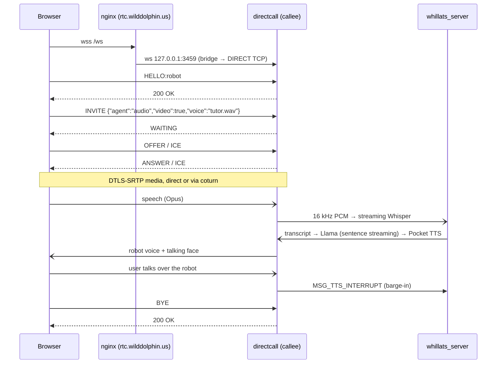
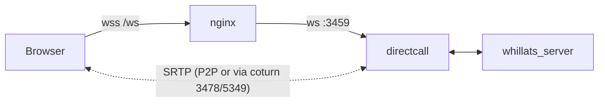
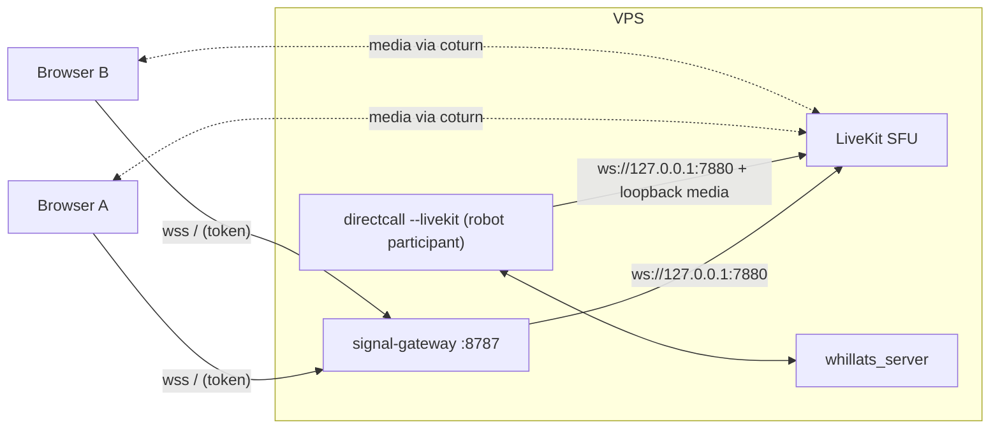

# Talk to the Robot: browser → AI-powered WebRTC robot

## The pitch

Open `https://rtc.wilddolphin.us` in any browser, press **Call**, and talk.
A robot answers within about a second, in a voice you choose, with an animated
face. It is a real WebRTC call, not a chat box with a microphone button:

- **Barge-in like a person.** Interrupt mid-sentence and the robot stops, listens
  and answers the new question. The synthesizer is aborted, not just muted.
- **A voice that means something.** The robot can speak in a voice cloned from
  10 seconds of a consenting speaker (a teacher, a brand voice, a family member
  reading bedtime stories), switchable mid-call with one message.
- **Private by construction.** Speech recognition, the language model and the
  voice all run on our own VPS. No audio leaves the server, there is no
  per-minute cloud bill, and no third party trains on the conversation.
- **Any network.** ICE + coturn (3478/5349) get media through hotel Wi-Fi and
  mobile carriers; the robot hangs up cleanly when a laptop lid closes.

### Who it is for

| Use | Why a WebRTC robot wins |
|-----|-------------------------|
| Language practice partner | Whisper detects the language per utterance; the robot replies in it, at conversational latency. |
| Kiosk / reception desk | Browser only, no app install; talking face makes it approachable. |
| Live interpreter in a group call (LiveKit phase) | Robot joins a room, listens to each speaker and voices the translation, optionally in the speaker's own cloned voice (Pocket TTS covers en, es, fr, de, it, pt). |
| Accessibility | Voice-first web UI for users who cannot type. |

## How a call works

Latency targets per turn (CPU-only VPS, from the components' published and
measured numbers; to be confirmed on the deployment box):

| Stage | Target |
|-------|--------|
| End of speech → final transcript (streaming Whisper small) | 300–600 ms |
| Transcript → first sentence (Gemma via llama.cpp, streamed) | 400–900 ms |
| First sentence → first audio (Pocket TTS, ~30 ms first chunk on desktop CPUs) | 50–150 ms |
| Network + jitter buffer | 50–150 ms |
| **Mouth-to-ear** | **≈ 0.8–1.8 s** |

## Phase 1: one-to-one robot calls on the existing direct path

This needs no LiveKit changes and is what the code on `feat/webrtc-m156` is
built for.

What to do on the VPS:

1. **Bring `/ws` back.** nginx already routes `/ws` to 3459; the 502 means the
   directcall unit is down. Check `journalctl -u directcall3-talkingface5 -b`
   for the reason, then deploy this branch.
2. **Let systemd stop it cleanly.** directcall now hangs up active calls on
   `SIGTERM` and exits within 10 s. Add to the unit:
   `KillSignal=SIGTERM`, `TimeoutStopSec=15`, `Restart=on-failure`.
3. **Enable personalized voices.** Build whillats with
   `-DWHILLATS_POCKET_TTS=ON`, run
   `third_party/pocket-tts-raven/tools/prepare_models.sh`, and set
   `POCKET_TTS_MODELS_DIR`, `POCKET_TTS_VOICES_DIR`, `POCKET_TTS_VOICE` in the
   unit. Put only clips with documented consent in the voices directory.
4. **Ship a page.** `ws_test.html` already speaks the protocol; point it at
   `wss://rtc.wilddolphin.us/ws` and add a voice picker that sends
   `{"type":"voice","name":"…"}`.

Limits: one call per directcall instance (others get `486 Busy Here`), no
recording, no multi-party.

## Phase 2: the robot as a LiveKit participant

LiveKit already runs on the box (systemd `livekit`, API on 7880, rooms
auto-created, up to 20 participants), and the signal gateway on 8787 already
issues access to it. Making the robot a room participant turns the 1:1 demo
into a product:

What LiveKit adds over the direct path:

- **Many humans, one robot**: family or classroom sessions, the interpreter use
  case, up to the configured 20 participants.
- **SFU features for free**: simulcast, congestion control across receivers,
  reconnection and resume in the browser SDK, recording/egress if added later.
- **No firewall change for the robot**: it runs next to LiveKit and connects
  over loopback, so the closed 7881–7892 ports do not affect it.

How to build it:

1. A `LiveKitPeer` in `examples/direct` that speaks LiveKit's signal protocol
   (protobuf `SignalRequest`/`SignalResponse` over WebSocket to `/rtc`) on top
   of the M156 PeerConnection code that exists now. LiveKit negotiates separate
   publisher and subscriber PeerConnections; both share the factory and the
   speech ADM. `EndCall()` maps to a `LeaveRequest`, so the new teardown rules
   apply unchanged.
2. Mix the subscribed audio tracks (or pick the active speaker) into the
   speech ADM's input, and publish the robot's TTS audio plus the talking-face
   video track.
3. The gateway mints a token for identity `robot-<room>` when a user presses
   **Call robot**, and starts (or signals) a robot instance for that room.
4. Using LiveKit's official C++/Rust client SDK instead is possible, but it
   ships its own libwebrtc, which would conflict with the in-tree WebRTC that
   the speech ADM is compiled into.

### LiveKit setup items worth fixing first

These come from the current server layout:

| Finding | Recommendation |
|---------|----------------|
| API (7880) listens on the public IP as well as 127.0.0.1; only the firewall protects it | Bind it to 127.0.0.1; nothing outside the box needs it. |
| One API key (`signal`) for everything | Give the robot its own key so it can be rotated or revoked without touching the gateway. |
| Media ports 7881/tcp, 7882–7892/udp are closed, so every browser stream relays through coturn | Fine to start. Opening the UDP range would remove a relay hop for most users (lower latency, less coturn bandwidth); that is a firewall decision to take deliberately. |
| `/etc/signal-gateway` backups stay on the server's own disk | Copy them off the box; a disk failure currently loses config and keys together. |

## Responsible voice cloning

The voice feature is what makes the demo memorable, and also what can do harm.
Kyutai's terms for Pocket TTS forbid cloning without consent and passing
synthetic speech off as real. The implementation only accepts clips that an
operator placed on the server, and peers can only select them by name. Keep a
consent record per clip, and have the page say that the robot's voice is
synthetic.
